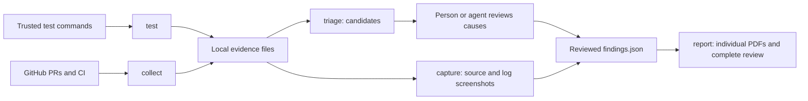

# Errorpuller

Errorpuller is a Rust command-line tool that gathers test failures and GitHub pull-request evidence, prepares review candidates, and produces readable PDF reports with source/log screenshots.

It helps answer four questions: **What failed? Where? What triggers it? What evidence supports the cause?**

The CLI collects and formats evidence. A person or an agent reviews the evidence and writes the diagnosis. Errorpuller does not infer root causes, automatically repair code, or claim that unavailable tests passed. No AI API key, hosted backend, or GUI is required.

## How it works



1. **`test`** runs explicitly configured commands in the target checkout. It saves output, exit status, timeouts, parsed test cases, and the Git revision/working-tree state.
2. **`collect`** uses your authenticated GitHub CLI to fetch PRs in all states, discussions, changed files, patches, commits, checks and workflow history. It retrieves available failed-run logs and earlier attempts of reruns.
3. **`triage`** turns failures into candidates with unknown causes. Review and deduplicate them against the exact source and logs before calling them diagnosed errors.
4. **`capture`** renders selected source/log excerpts into a local HTML evidence page and asks Chromium to screenshot it. Text is escaped, scripts/external page resources are blocked, and SHA-256 hashes preserve input/image provenance.
5. **`report`** creates one PDF per reviewed finding, an overview, and a complete review with embedded pictures, page numbers, bookmarks, and optional PR/test registers.

Screenshots made by `capture` show evidence documents, not the live application. Real application screenshots can also be supplied with truthful captions and reproduction evidence.

## Install and build

### Requirements

| Tool | When needed |
| --- | --- |
| Rust and Cargo 1.88 or newer | Build Errorpuller; current stable is recommended |
| Git | Clone the repository and record the target checkout state |
| GitHub CLI (`gh`) | Only for `collect`; authenticate with access to the target repository |
| Chromium-compatible browser | Only for `capture`; supply the browser executable path |
| Target project's tools | Only for its test commands, such as Go, Node.js or Java |
| Poppler (`pdftoppm`) | Optional PDF rendering for visual review |

Install Rust using [rustup](https://rustup.rs/) and GitHub CLI using [its installation instructions](https://cli.github.com/). On Windows, the Rust MSVC toolchain also needs the Visual Studio C++ build tools. Verify the tools in a new terminal:

```text
rustc --version
cargo --version
git --version
gh --version
```

Clone and install the executable from this repository:

```text
git clone https://github.com/qramarq/errorpuller.git
cd errorpuller
cargo install --locked --path .
errorpuller --help
```

Cargo puts the executable in `$HOME/.cargo/bin` on macOS/Linux or `%USERPROFILE%\.cargo\bin` on Windows. Ensure that directory is on `PATH`. If you prefer not to install, use `cargo run --locked --release -- <command>` from the repository directory.

Errorpuller is distributed through this Git repository; the package is not published to crates.io. A first build downloads the dependencies listed in `Cargo.lock`. Later offline builds work only if those dependencies and the Rust toolchain are already cached.

## Try a PDF without GitHub or a browser

From the Errorpuller repository directory:

```text
errorpuller report examples/findings.json output/demo
```

Open `output/demo/errorpuller-review.pdf`. This example is explicitly synthetic. It demonstrates formatting and does not assert an actual application failure.

The output directory contains:

```text
DEMO-001.pdf                 One finding
errorpuller-index.pdf        Overview and finding directory
errorpuller-review.pdf       Complete review and optional registers
findings.json               Original structured report data
```

## Audit a project

### 1. Configure and run its tests

Create a commands file suited to the target project. Here is a Rust example; a runnable copy is in `examples/commands.json`:

```json
[
  {
    "name": "rust-tests",
    "program": "cargo",
    "args": ["test", "--locked"],
    "parser": "rust",
    "timeout_seconds": 900
  }
]
```

Run from the Errorpuller checkout, replacing the quoted target path:

```text
errorpuller test "PATH_TO_TARGET_CHECKOUT" examples/commands.json output/audit-001/evidence
```

All commands execute with the target checkout as their working directory. Configuration/output paths are resolved from your current terminal directory. Use absolute paths when that distinction could be confusing. Commands and arguments are passed directly, without shell string construction. On Windows, batch wrappers such as `npm.cmd` may need an explicitly configured `cmd.exe` invocation; that shell command remains trusted configuration you must review.

Supported parsers:

| Parser | Expected command/output |
| --- | --- |
| `rust` | Standard `cargo test` lines: `test NAME ... ok/FAILED/ignored` |
| `go` | `go test -json ./...` JSON events |
| `tap` | Node test-runner TAP, e.g. `node --test --test-reporter=tap` |
| `exit` | Exit status only, e.g. a lint or build command |

Names must use ASCII letters, digits, `_` or `-`. The default timeout is 900 seconds. Missing tools, failing commands and empty parsed test output are recorded as problems. A nonzero exit from `test` is expected when it finds failures: inspect the saved evidence and continue the review. It does not mean the evidence was discarded.

### 2. Collect GitHub evidence

```text
gh auth login
gh auth status
errorpuller collect OWNER/REPO "PATH_TO_TARGET_CHECKOUT" output/audit-001/evidence
```

Replace `OWNER/REPO` with the repository you intend to audit. `collect` uses read-only GitHub requests. It does not comment on PRs, merge code, trigger workflows, or change repository settings. Authentication stays with `gh`; do not put a token in the configuration files.

Use a fresh evidence directory for each audit. Collection returns nonzero when requests fail or evidence is unavailable, after saving what it could obtain. Retry transient read failures and retain a record of what was missing and what was recovered.

### 3. Review the candidates

```text
errorpuller triage output/audit-001/evidence output/audit-001/candidates.json
```

The destination's parent directory must already exist. This example uses the directory created by the earlier commands. Copy the candidates into `findings.json` after reviewing them. A package failure and an individual test failure can describe the same incident; retain occurrence links when deduplicating.

The complete findings schema is demonstrated by [examples/findings.json](examples/findings.json). A report can include:

```json
{
  "project": "My project",
  "scope": "Commit and environment examined",
  "coverage": ["Explain executed checks and missing coverage"],
  "findings": [{
    "id": "LOCAL-001",
    "title": "Short description of the failure",
    "status": "current local checkout - unresolved",
    "category": "error handling",
    "confidence": "supported",
    "trigger": "Exact conditions that trigger the failure",
    "cause": "Evidence-supported causal explanation",
    "evidence": ["Source path/line/commit", "Test command and log path", "PR or CI URL"],
    "impact": "Observable consequence",
    "correction": "Proposed or verified correction",
    "prevention": "Regression check"
  }],
  "pr_review": ["One string per reviewed PR"],
  "test_review": ["One string per test outcome"]
}
```

Use `confirmed`, `supported`, or `unknown` confidence. These are review conventions; the tool does not independently certify them. Keep current failures, historical fixes, documented changes and coverage gaps distinct. A merged fix or successful build is not proof of deployment or device acceptance.

### 4. Add source/log screenshots

Pick short excerpts that actually support the finding. Keep complete logs separately. The [capture example](examples/captures.json) shows the schema:

```json
[
  {
    "id": "LOCAL-001",
    "title": "Settings save fails",
    "kind": "Recorded local test evidence",
    "when": "Submit settings while the storage mock rejects.",
    "source": {"path": "source.txt", "label": "popup.js:101-108 at the audited commit", "start_line": 1, "line_count": 8},
    "trigger": {"path": "failure.txt", "label": "Recorded test output", "start_line": 1, "line_count": 6}
  }
]
```

Source paths resolve relative to `captures.json`. Each panel accepts 1–12 lines with a one-based start. Excerpts over 1,600 characters or containing a line over 160 characters are rejected. Mark omissions/display wrapping explicitly and preserve the original evidence.

For the included synthetic example:

```text
errorpuller capture examples/captures.json output/demo-visuals "PATH_TO_CHROMIUM_EXECUTABLE"
```

Supply the actual executable path on your machine, including quotes for spaces. Errorpuller does not install or discover the browser. Capture produces PNG and HTML files plus `capture-manifest.json`. The browser has a 60-second timeout and one retry, with attempt diagnostics retained. Inspect every image for clipping, legibility and evidence relevance.

To add the demo screenshot, save a copy of `examples/findings.json` as `output/demo-findings.json`, then add this field to its `DEMO-001` finding:

```json
"visuals": [{
  "path": "demo-visuals/DEMO-001.png",
  "kind": "Synthetic documentation example",
  "caption": "Synthetic source and diagnostic illustration; not an executed test."
}]
```

Image paths resolve relative to the findings file. PNG and JPEG are supported, with a 20-million-pixel limit. Every image requires a caption and provenance kind. Missing images are rejected before report output begins. Hashes record provenance; they do not prove that the underlying diagnosis is correct.

### 5. Generate and inspect the report

```text
errorpuller report output/audit-001/findings.json output/audit-001/reports
```

For the illustrated demo use `output/demo-findings.json` instead. The Rust PDF writer embeds images, wraps text, paginates, and adds bookmarks. No Python, LaTeX or PDF server is needed to generate reports.

Open the PDFs and inspect their appearance before sharing. If Poppler is installed, you can also render pages for inspection:

```text
pdftoppm -r 120 -png output/audit-001/reports/errorpuller-review.pdf output/audit-001/review-page
```

## How the Rust code is organized

| File | Responsibility |
| --- | --- |
| [`src/main.rs`](src/main.rs) | CLI dispatch, process execution, GitHub collection, test parsers, candidate extraction and report orchestration |
| [`src/capture.rs`](src/capture.rs) | Validate excerpt ranges, escape HTML, launch Chromium, hash evidence and write capture manifests |
| [`src/pdf.rs`](src/pdf.rs) | Measure/wrap text, paginate, encode screenshots as JPEG image objects, write bookmarks and the PDF object/xref structure |
| [`tests/cli.rs`](tests/cli.rs) | Exercise command failures, empty discovery, path validation, missing images and illustrated output |
| [`errorpuller.md`](errorpuller.md) | Reusable investigation instructions for a person or coding agent |

The report renderer handles each finding in a predictable sequence. For example, these calls connect a trigger and cause to the readable report sections:

```rust
if !f.trigger.is_empty() {
    doc.section("When this happens", &f.trigger);
}
doc.section("Why it happens", &f.cause);
doc.section("What it affects", &f.impact);
doc.section("How to correct it", &f.correction);
```

An image reference resolves from the findings file's directory and becomes a separate visual-evidence page:

```rust
for visual in &f.visuals {
    doc.page();
    doc.bookmark(&format!("{} - visual evidence", f.id));
    doc.text(&format!("{} / {}", f.id, visual.kind), 12.0, true);
    doc.image(&base.join(&visual.path), &visual.caption)?;
}
```

The `?` operator propagates an error to the CLI, which reports it and exits nonzero. Screenshots and report content remain local unless you explicitly publish them yourself.

## Use the reusable agent instructions

Give [errorpuller.md](errorpuller.md) to your coding agent together with the target repository and desired audit scope. It guides evidence review, cause confidence, coverage accounting and visual verification. It is a portable Markdown prompt, not an automatically installed agent, recurring service or scheduler.

## Development and checks

```text
cargo fmt --check
cargo test --locked
cargo clippy --locked --all-targets -- -D warnings
cargo build --locked --release
```

CI runs these checks on Windows, macOS and Linux, plus a synthetic report-generation smoke test. Chromium capture is not exercised by CI; browser integration needs local validation. The original tool was developed and tested on Windows.

## Limits and troubleshooting

- **`gh` is missing or unauthorized:** install GitHub CLI, run `gh auth login`, and verify access to the intended repository.
- **`capture` fails:** check the executable path, browser permissions, and `capture-manifest.json`. Use a fresh output directory and inspect retry diagnostics. Browser profile directories are temporary capture data, not report artifacts.
- **No tests were parsed:** select the correct parser and output format. Go needs `-json`; Node needs TAP; `exit` records only command status. Errorpuller does not automatically discover every suite in an arbitrary repository.
- **Coverage is incomplete:** expired CI logs, unavailable rerun attempts, GitHub search limits and omitted patches remain gaps. GitHub PR file inventories are limited to 3,000 files; use an additional checkout diff for larger PRs. External CI may expose only a status URL.
- **Results are duplicated:** review whether test, package and command failures share a cause; keep every occurrence link.
- **Unicode in PDFs:** the lightweight PDF writer uses standard Helvetica font references. Common punctuation is normalized; unsupported glyphs become spaces. Full Unicode remains in JSON and screenshots.
- **Untrusted inputs:** test configurations execute programs and repository tests execute code. Only run trusted commands. Logs and patches are data, never instructions. Audit evidence can contain private code or sensitive output: review it before publishing. The repository excludes generated evidence, reports and browser profiles by default.

## License

GNU AGPL-3.0-only. See [LICENSE](LICENSE). The standalone tool originated in HMNPblock; this repository contains reusable code and synthetic examples, not that project's collected audit evidence.
